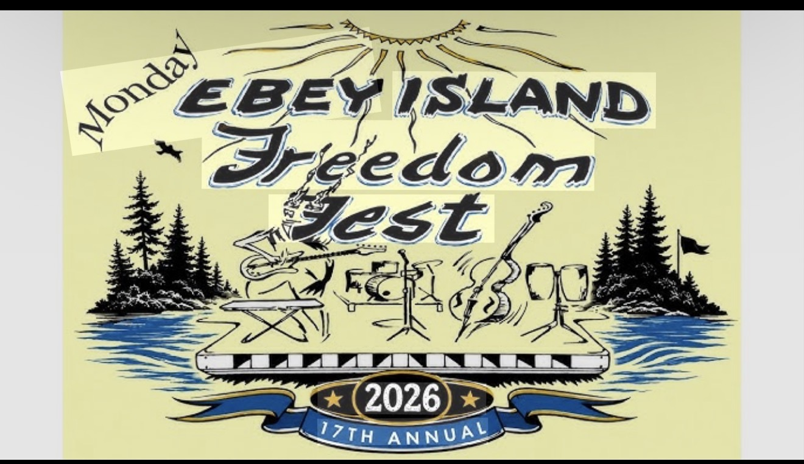

# Ebey Island Freedom Fest app

An iOS, Android, and web app for the Ebey Island Freedom Fest, used before, during, and after the event. Freedom Fest runs four days every Labor Day weekend (Friday to Monday) with two stages, Shaman Stage and Main Stage. Entry, parking, bands, and camping are all free.

The app has two jobs:

1. **Help the event run.** Volunteers keep a live public list of needs that anyone can claim, and each crew (kitchen, lights and sound, bands, security, parking, and so on) gets its own messaging channel.
2. **Help the event get funded.** Donations (GoFundMe, Venmo) and merchandise, with online sales built into the app.

This is a personal gift to the community, so cost and effort are kept to a minimum. Each feature ships as a small MVP first, and Phase 2 items wait until the MVP is in use.

## Features

Each feature is tracked as an issue with MVP and Phase 2 checklists. Labels: `mvp`, `phase-2`, `decision` (open question to settle first), `proposed` (not yet accepted).

| # | Feature | Summary |
|---|---------|---------|
| 1 | Public live needs board | Volunteers post and update needs; anyone can view them |
| 2 | Need claiming | Anyone can claim a need so effort isn't duplicated |
| 3 | Team messaging channels | One channel per volunteer crew |
| 4 | Structured need cards with partial claims | Category, urgency, phase, location, quantity; "I'll bring 5 of 20" |
| 5 | Roles, teams, and permissions | Public → Helper → Team member → Team lead → Coordinator → Owner |
| 6 | Notifications and event-wide alerts | Claim updates, escalation for critical needs, weather/evacuation alerts |
| 7 | Interactive site map with need pins | Event's own map image with stations, facilities, and need pins |
| 8 | Messaging structure and tools | Leads channel, need-linked threads, pinned team info |
| 9 | Lost and found | Lost/found reports, matching, hand-off; lost children go straight to security |
| 10 | Live event schedule | Now/next, stage grid, live delay and cancel updates |
| 11 | Merchandise store | Storefront, T-shirt giveaways, booth pickup, hosted payments |
| 12 | Ticketing and gate entry | **On hold:** the event is free, so remove or repurpose |
| 13 | Event info hub | Info pages, searchable FAQ, announcements |
| 14 | Shared Freedom Fest album | Signed-in photo sharing by day, stage, and performer |

## Constraints

- **Platforms:** iOS, Android, and web from one codebase; Blazor preferred.
- **Scale:** a few thousand users total, about 1,000 or fewer at once.
- **Cost:** as low as possible; portable between hosts or self-hosted (containers).
- **Sign-in:** Google and Facebook; the public can use the app without an account, with some features off.
- **Copy:** always "Freedom Fest", never "fest" on its own.
